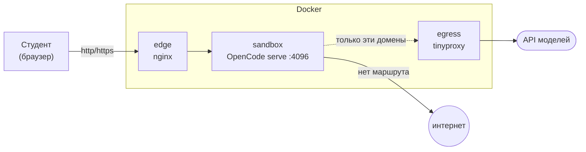

# Стенд OpenCode для студентов-экономистов

Демо-песочница: студент открывает в браузере один адрес, вводит один пароль и
начинает работать с агентом на учебных данных. Никаких установок, туннелей и
настроек на стороне студента.



## Модель безопасности

Это главное, что нужно понять про стенд: **правила OpenCode — не песочница**.
Из документации:

> `shell` runs with the host user's filesystem, process, and network authority.

То есть `permissions` и `policies` — это вежливая просьба, а не граница. Они
защищают от случайной ошибки агента, но не от студента, который решит
«посмотреть, что будет». Поэтому границей сделаны четыре слоя ОС и только
последний — конфиг.

| Слой | Что делает | Обойти можно? |
| --- | --- | --- |
| **1. Сеть** | Песочница в docker-сети с `internal: true` — маршрута в интернет нет вообще. Наружу только через `egress`-прокси, а он пускает лишь домены из `egress/allowlist`. | Нет. Даже если агент выполнит `curl`, ему некуда идти. |
| **2. Контейнер** | gVisor (`runsc`) вместо обычного runc, non-root, `read_only` rootfs, `cap_drop: ALL`, `no-new-privileges`, лимиты CPU/RAM/PID, без `docker.sock`. | Крайне тяжело. Kernel-exploit в gVisor не даёт root на хосте. |
| **3. Конфиг** | `/etc/opencode/opencode.json` в системном каталоге: агент не выходит за рабочую папку, не читает секреты, не может сменить провайдера на ваш платный ключ. | Да, это лишь удобство. Но за ним ничего интересного нет. |
| **4. Edge** | Наружу торчит только nginx. Порт самого OpenCode не публикуется. | — |

Проверить всё это можно одной командой: `scripts/50-verify-isolation.sh`.
Она запускает тесты **в обход агента**, через `docker exec`, и честно говорит,
что настроено, а что нет.

> **Эта схема требует root на сервере.** Без root слои 1 и 2 не построить:
> ни контейнеров, ни gVisor, ни user namespaces. Что остаётся в таком случае —
> в разделе [«Требование: root»](#требование-root-на-сервере); коротко: песочницы
> не будет, и это надо учесть заранее.

### Что осознанно оставлено как есть

- **Все студенты в одном контейнере и видят сессии друг друга.** Это принятое
  решение: одна пара логин/пароль, один URL. Один студент может испортить
  работу другого в той же папке — между парами есть `scripts/90-reset.sh`.
- **Пароль один на всех.** Он уходит по сети открытым текстом, если
  `ENABLE_TLS=false`. Для внутренней сети это нормально; для интернета —
  включайте TLS.
- **Студент может положить контейнер** (например, съесть всю память). Ограничено
  `mem_limit`/`pids_limit`, лечится `docker compose restart sandbox`.
  Уронить хост или соседние сервисы — нет.

## Быстрый старт

```bash
cd demo/opencode-sandbox

cp .env.example .env
$EDITOR .env                      # обязательно смените SANDBOX_PASSWORD

scripts/00-preflight.sh           # что не так с сервером
sudo scripts/10-install-gvisor.sh # если preflight не нашёл runsc
scripts/20-sync-workspace.sh      # датасеты + стартовые файлы
scripts/30-up.sh                  # собрать и поднять
scripts/50-verify-isolation.sh    # убедиться, что защита работает
```

`40-info.sh` печатает адрес и логин с паролем — это то, что раздаётся студентам.

## Модели

**Подключать ничего не нужно.** Провайдер `opencode` («OpenCode Free») отдаёт
модели без кредов: его `apiKey` — это буквально строка `public`. Проверено
запросом к работающему серверу. OAuth, API-ключи, Console — не требуются.

Дефолт закреплён в `config/opencode.json`: `opencode/big-pickle`.

Если модели пропадут из UI после обновления версии — виновата одна из двух вещей,
и обе проверяются за секунду:

```bash
# 1. ID провайдера не изменился?
curl -s -u "opencode:$(sed -n 's/^OPENCODE_SERVER_PASSWORD=//p' .env)" \
  http://127.0.0.1:4096/api/provider | head -c 300

# 2. Прокси ничего не режет?
docker compose logs egress | grep -i blocked
```

Платные провайдеры запрещены в `policies`: студент не подключит свой ключ и не
потратит ваш бюджет.

## Что ограничено у агента

Три разных вопроса, которые легко перепутать. Ниже — что реально работает.

### 1. Команды

Ограничивать можно, и в v2 для этого есть точный механизм: действие `shell`
в массиве `permissions` (в v1 оно называлось `bash`; правила применяются
«последнее совпавшее выигрывает»).

Сделано так: широкий `{ "shell": "*" → ask }` плюс список разрешённой рутины
(`python3`, `ls`, `cat`, `grep`, `awk`, `git status` и т.п.). Всё, чего нет в
списке, агент спрашивает у студента прямо в UI. `rm` оставлен на `ask`
намеренно.

Отдельно — жёсткие запреты в `policies` (например `shell:sudo *`,
`shell:curl *`). Их отличие принципиально: правило в `permissions` студент
может снять кнопкой «Allow always» (это сохраняется как проектное правило), а
`policies` — нет. Политика превращает `allow`/`ask` в `deny` и никогда не даёт
доступа.

**Честно про границы.** Документация OpenCode сама предупреждает: «`shell` runs
with the host user's filesystem, process, and network authority», а разбор
команды — «best effort», и вместо чёрных списков она рекомендует узкий белый.
Демонстрация того, что белый список протекает: в списке есть `python3 *`, а
значит проходит и `python3 -c "..."` — то есть любой код. Вывод: это удобство и
защита от случайности, а не граница безопасности. Граница — контейнер.

### 2. Загружаемые файлы

В OpenCode нет лимита на размер произвольных файлов. Есть только обработка
**картинок** — ключ `media.image` (`auto_resize`, `max_width/height`,
`max_base64_bytes`); он настроен.

За остальное отвечает лимит диска у каталога `/work`, и вот тут нужен шаг при
развёртывании — способ зависит от файловой системы хоста:

- если в контейнере используется overlay2 на xfs с `pquota` — хватает
  `StorageOpt: size=2G`;
- иначе делается честная квота на каталог: файл-образ ext4 нужного размера,
  смонтированный в `workspace/` (нужен root один раз).

Второе работает всегда, поэтому по умолчанию пойду им. Для демо 2 ГБ на всех
хватает с большим запасом: датасеты по 1–10 МБ.

Дополнительно включён `tool_output` (`max_lines: 400`, `max_bytes: 32 КБ`),
чтобы `cat` большого CSV не раздувал ни контекст, ни диск.

### 3. Интернет

Ограничение делается на уровне контейнера, а не настройками OpenCode: у
песочницы нет маршрута наружу, кроме прокси с белым списком. Разрешены ровно
два домена — и этого достаточно:

```
(^|\.)opencode\.ai$          ← сами модели: /inference/openai/v1, apiKey "public"
(^|\.)models\.opencode\.ai$  ← каталог моделей (кэшируется в образ)
```

Это ответ на вопрос «не отвалится ли доступ к моделям»: **нет**. Модели живут на
`opencode.ai`, а не в свободном интернете, и этот домен в белом списке. Студенты
теряют произвольный интернет (`curl` на сторонний сайт), а модели — нет.

Что стоит знать: `ask` для `webfetch`/`websearch` не нужен — эти инструменты
запрещены в `policies`, а сети для них и так нет.

## Как забрать файлы, которые сделал агент

Агент пишет графики и таблицы в рабочую папку. Забрать их можно двумя путями.

**Путь 1 — из интерфейса.** У v2 есть файловый API (`/api/fs/list`,
`/api/fs/read/`), и UI показывает содержимое проекта. Проверено на живом
сервере: API отдаёт файл с корректным `content-type` и `accept-ranges`, то есть
скачивание работает и оттуда, под тем же паролем.

**Путь 2 — страница `/files/`.** Гарантированный путь, который не зависит от
того, как устроен UI:

```
http(s)://<адрес стенда>/files/
```

Обычный список файлов, любой скачивается. Как устроено: каталог `workspace/`
примонтирован в контейнер edge **только на чтение**, файлы отдаются с
`Content-Disposition: attachment`, листинг — через `autoindex`.

Три детали, которые здесь важны:

- **Пароль тот же, что у OpenCode.** Отдельного секрета нет: `edge/htpasswd`
  генерируется в `scripts/30-up.sh` из `SANDBOX_PASSWORD`, логин `opencode`.
  Браузер запомнит его после первого ввода, так что спрашивать будет один раз.
- **Ничего не исполняется.** Файлы уходят вложением, а не отрисовываются. Иначе
  загруженный студентом HTML выполнялся бы на том же origin, что и UI, и мог бы
  вычитать пароль из `localStorage`. Служебные файлы (с точки) закрыты.
- **Каталог общий.** Это ровно та же папка, которую все видят как `/work`,
  включая чужие результаты. При одном общем логине иначе и быть не может;
  персональных папок здесь нет — так и задумано.

Если выкладывать файлы наружу не нужно — удалите `location /files/` из обоих
`edge/site.*.conf` и монтирование `edge/htpasswd` из `docker-compose.yml`.

## Эксплуатация

| Задача | Команда |
| --- | --- |
| Адрес и пароль | `scripts/40-info.sh` (пароль целиком: `--show`) |
| Логи агента | `docker compose logs -f sandbox` |
| Что режет прокси | `docker compose logs egress \| grep -i blocked` |
| Перезапуск | `docker compose restart sandbox` |
| Сброс между парами | `scripts/90-reset.sh` |
| Остановить | `scripts/99-down.sh` |
| Стереть всё | `scripts/99-down.sh --purge` |

### Студент «сломал» стенд

```bash
docker compose restart sandbox        # если завис
scripts/90-reset.sh                   # если наделали мусора в папке
```

Данные в `workspace/data/` при сбросе не трогаются.

### Студенты не могут сохранить файл (Permission denied)

Почти всегда это несовпадение uid: контейнер работает от `SANDBOX_UID`, а
каталог `workspace/` на хосте принадлежит другому пользователю.

```bash
stat -c '%u:%g' workspace            # посмотреть владельца
chown -R 1000:1000 workspace         # либо так
# либо в .env: SANDBOX_UID=<uid> SANDBOX_GID=<gid>
docker compose up -d --build sandbox
```

`scripts/00-preflight.sh` проверяет это заранее.

## Требование: root на сервере

Эта схема ставит **Docker и gVisor, а для этого нужен root** (или sudo). Проверьте
до развёртывания:

```bash
sudo -n true && echo "root есть" || echo "root нет — схема не встанет"
```

Если root нет — переходите к **варианту B** ниже. Полностью заменить изоляцию
там не получится: без root недоступны ни контейнеры, ни user namespaces
(`unshare -Ur` → `Operation not permitted`, в Ubuntu 24.04+ это
`kernel.apparmor_restrict_unprivileged_userns=1`), а значит ни gVisor, ни
bubblewrap, ни rootless podman.

### Вариант B: сервер без root

Так был развёрнут предыдущий стенд — см. сохранённый журнал
[`docs/previous-deployment-runbook.md`](docs/previous-deployment-runbook.md).

Я проверил на живом rootless-сервере (systemd 259), какие директивы user-юнита
**действительно** что-то делают. Результат неприятный:

| Механизм | Измеренный результат |
| --- | --- |
| `MemoryMax`, `CPUQuota`, `TasksMax` | **работают** — это cgroup, а не mount namespace |
| `NoNewPrivileges=yes`, `SystemCallFilter=@system-service` | принимаются (пользователю и так нечего повышать) |
| `ProtectSystem=strict` | юнит стартует, **эффекта нет** |
| `ProtectHome`, `InaccessiblePaths`, `ReadOnlyPaths` | **не действуют**: `~/.ssh` виден во всех случаях |
| `PrivateTmp=yes` | принимается; изоляцию `/tmp` подтвердить не удалось |
| `IPAddressDeny=any` | юнит стартует, но **трафик не режется** — сеть работает |
| `PrivateUsers=yes` | не действует, uid не меняется |

Ключевое: `systemd-run -p X ...` **возвращает успех, даже когда ограничение
не применяется**. Поэтому «юнит запустился» здесь ничего не доказывает — нужно
проверять эффект. Именно это делает `scripts/50-verify-isolation.sh`, и на
rootless-сервере он честно покажет провалы.

Вывод, который надо принять: **без root никакой песочницы нет.** Остаётся только

1. **отдельный пользователь**, в `$HOME` которого нет ничего ценного — ни ключей,
   ни токенов, ни доступа к другим сервисам. Это единственная реальная защита;
2. **лимиты ресурсов**, чтобы шумный агент не уронил сервер;
3. правила OpenCode (обходятся) и пароль на входе (это контроль доступа, не изоляция).

Практически: агент в варианте B может прочитать `~/.ssh/authorized_keys`,
`~/.config/opencode-web.env` и приватный ключ CA Caddy. Планируйте развёртывание
с этим допущением — например, не размещайте на этой машине ничего другого.

## Что уже подтверждено на живом сервере

Проверено запросами к работающему экземпляру v2.0.32 (не по документации):

- **Пароль.** v2 всегда требует пароль и берёт его из `OPENCODE_SERVER_PASSWORD`.
  Логин всегда `opencode`. Никаких `--password` и `opencode service set` не нужно.
- **Бесплатные модели работают без кредов.** Провайдер `opencode`:
  `apiKey: "public"`, `baseURL: https://opencode.ai/inference/openai/v1`,
  стоимость `0`. Значит **OAuth-шага в развёртывании нет вообще**.
- **Модели и дефолт.** `big-pickle` (дефолт), `glm-5.3-flash-free`,
  `deepseek-v4.1-flash-free`, `mimo-v2.6-flash-free`, `beam-free`,
  `longcat-2.5-preview-free` и др. Дефолт закреплён в `config/opencode.json`.
- **Для egress хватает `opencode.ai`.** Остальные строки в `egress/allowlist`
  закомментированы как ненужные.
- **v1 не использовать.** В веб-UI v1 воспроизводимо падали Settings и New
  session; в v2.0.32 те же сценарии проходят.

## Что осталось проверить

Единственный пункт, который нельзя подтвердить без развёртывания:

**Тег базового образа.** `ghcr.io/anomalyco/opencode:2.0.0` взят из документации,
но версия CLI на живом сервере — `2.0.32`. Проверьте перед сборкой:

```bash
docker run --rm --entrypoint sh ghcr.io/anomalyco/opencode:2.0.32 -c 'opencode --version'
```

Если тег не существует — поменяйте `OPENCODE_IMAGE` в `.env` на рабочий.
Скрипт `scripts/00-preflight.sh` сообщит об этом первым делом.

## Файлы

```
docker-compose.yml            топология: sandbox + egress + edge
.env.example                  пароль, порт, лимиты, TLS

docker/Dockerfile             официальный образ + python/pandas + guardrails
docker/entrypoint.sh          пароль единственного входа и запуск serve

config/opencode.json          слой 3: permissions, policies, модель (монтируется ro)

HANDOFF.md                    план развёртывания на новом сервере — читать первым
docs/previous-deployment-runbook.md   журнал прошлого развёртывания (источник уроков)

egress/Dockerfile             прокси
egress/tinyproxy.conf         фильтр по домену, журнал блокировок
egress/allowlist              ← сюда добавлять домены

edge/entrypoint.sh            выбирает http/tls и собирает конфиг
edge/site.http.conf           вариант без TLS (по умолчанию)
edge/site.tls.conf            вариант с TLS

workspace/                    рабочая папка студентов (bind-mount в /work)
workspace.template/           эталон: README, AGENTS.md, пример

scripts/00-preflight.sh       проверки сервера
scripts/10-install-gvisor.sh  установка gVisor
scripts/20-sync-workspace.sh  данные и шаблоны в рабочую папку
scripts/30-up.sh              сборка и запуск
scripts/40-info.sh            адрес, логин, пароль
scripts/50-verify-isolation.sh проверка защиты
scripts/90-reset.sh           сброс между парами
scripts/99-down.sh            остановка
```

## Дальше

Если через пару занятий окажется, что студенты мешают друг другу, схему можно
развить до контейнера на студента, не меняя остальное: nginx умеет роутить по
имени залогиненного пользователя —

```nginx
set $upstream http://sandbox-$remote_user:4096;
proxy_pass $upstream;
```

Тогда у каждого свой контейнер и своя папка, а вход остаётся один.
